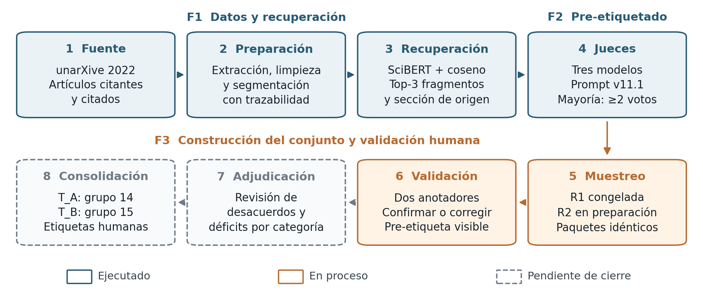
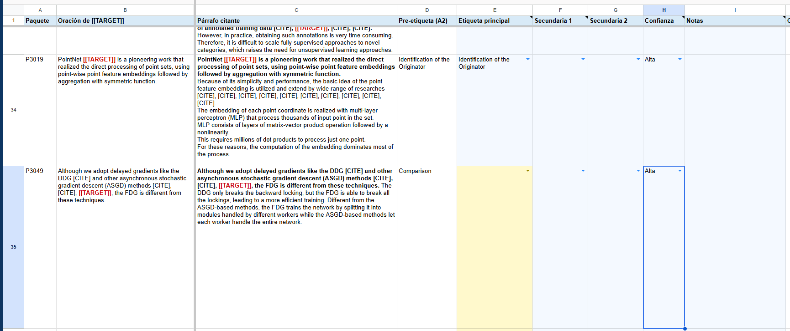
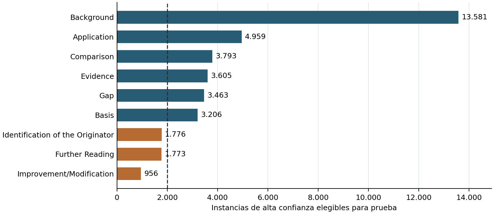

<h1 align="center">Primer informe de avance</h1>

**Título del proyecto:** Recuperación semántica y clasificación de la función de citas académicas en Computer Science.

**Integrantes:** Camilo Bejarano, German Rodriguez, Jose Arteaga y Sebastian Toro.

**Grupo:** 15 — conjunto de prueba T_B.  
**Fecha de corte:** 23 de octubre de 2026.

**Documento rector del procedimiento y las cuotas:** contrato de datos compartido de los grupos 14 y 15. [3]

## 1. Descripción breve de la propuesta de solución

El proyecto aborda la identificación automática de la función que cumple una cita en artículos científicos en inglés del área de Computer Science. La solución articula dos componentes: la recuperación semántica de los tres fragmentos más relevantes del artículo citado, mediante representaciones de SciBERT y similitud coseno, y la clasificación de la función de la cita. Se consideran nueve categorías: *Background, Gap, Basis, Comparison, Application, Improvement/Modification, Evidence, Identification of the Originator* y *Further Reading*. La evaluación prevista comparará un clasificador supervisado que recibe el contexto de cita, el título y el resumen del artículo citado con otro que incorpora el contexto, las secciones de origen y los fragmentos recuperados; adicionalmente, se contrastará su desempeño con un modelo de lenguaje comercial. [1, 10, 11]

La motivación surge de la dificultad de caracterizar las relaciones entre publicaciones mediante el conteo de citas. Una referencia puede proporcionar contexto, fundamentar un método, respaldar una afirmación o señalar una limitación, entre otras funciones. Distinguir estos propósitos exige criterios de anotación consistentes y datos que vinculen el contexto citante con el contenido del artículo citado. El proyecto busca construir ese recurso y evaluar el aporte de la evidencia recuperada a la clasificación. [1]

Durante el periodo reportado se desarrollaron actividades de extracción, limpieza, segmentación y recuperación de fragmentos; se consolidó un conjunto compartido de pre-etiquetas mediante tres jueces de lenguaje; y se formalizó y comenzó a ejecutar la validación humana con el grupo 14. El avance comprende F1, F2 y parte de F3. Al corte, la validación y la adjudicación continúan en proceso; no se presentan todavía resultados del ajuste supervisado, de la evaluación comparativa final ni del despliegue. [3–6]

**Nota de nomenclatura.** Las fases F1, F2 y F3 de la propuesta corresponden a las actividades A1, A2 y A3 de la documentación de desarrollo, respectivamente. Este informe utiliza la denominación «fase» y los identificadores F para mantener consistencia con la propuesta; los títulos de los documentos y los identificadores de los artefactos conservan su denominación original. F1 macro y F1 micro designan métricas de clasificación. [1, 3]

## 2. Recolección y preparación de los datos

### 2.1. Fuente y delimitación del corpus

Se utilizó unarXive 2022, derivado de fuentes LaTeX de arXiv, que conserva texto estructurado, secciones, párrafos y vínculos bibliográficos. El perfilamiento documentado identificó 405.947 artículos con alguna categoría `cs.*`. De sus 13.326.381 entradas bibliográficas, el 11,0 % se vinculaba con identificadores de arXiv; entre las referencias resueltas, el 66,1 % correspondía a artículos presentes en el subconjunto. Al restringir la categoría primaria a `cs.*`, `eess.*` o `stat.ML`, se obtuvieron 358.494 artículos y una cobertura interna del 72,6 %. [2, 12]

La construcción inicial se concentró en artículos citantes de cs.CV, cs.SI, cs.HC, cs.CY y cs.ET. El citado podía pertenecer a otro subcampo, siempre que estuviera disponible en el corpus. La consolidación más reciente registra, después de la limpieza, **1.113.513 contextos de cita, 50.538 artículos citantes y 31.532 artículos citados**, con 1.229.408 fragmentos. Estas cifras describen el corpus piloto preparado para la recuperación y el pre-etiquetado.

### 2.2. Limpieza, segmentación y trazabilidad

La preparación identificó marcadores resolubles, extrajo los contextos y almacenó una sola copia del texto de cada artículo citado. La segmentación respetó las secciones y adoptó como configuración de referencia un máximo de 300 palabras y dos párrafos por fragmento. Se eliminaron fragmentos duplicados, textos de menos de 15 palabras, segmentos sin sección identificada y residuos reconocibles de plantillas LaTeX; también se descartaron artículos sin fragmentos utilizables y sus contextos huérfanos. El filtrado inicial excluyó contextos de más de 1.000 palabras. El análisis exploratorio detectó excepciones al tamaño objetivo y motivó controles posteriores con el tokenizador de SciBERT. [2]

En la selección vigente de candidatos se exigió un cuerpo del citado de al menos 1.000 palabras tras la limpieza. Se descartaron extracciones de menos de 2.000 palabras que presentaban secciones nombradas pero ninguna introductoria, como control de artículos representados solo por apéndices. Los contextos de más de 512 tokens se excluyeron sin truncamiento; se retiraron los citantes detectados en otros idiomas y los casos con el mismo identificador como citante y citado. El control de idioma excluyó 11 artículos citantes del piloto y 21 de la extensión. [3]

Cada instancia conserva una clave formada por el artículo citante, el índice original del párrafo, las posiciones del marcador y el artículo citado. La clave de grupo identifica las citas contiguas, y cada fragmento recuperado mantiene un localizador estable. Se verificó la reconstrucción exacta por localizadores en una muestra de 300/300 contextos y fragmentos. Los archivos compartidos de pre-etiquetas contienen identificadores, localizadores y etiquetas; los paquetes con texto se distribuyen en hojas privadas. El demostrador se restringe a pares con licencias permisivas. [3, 4]

### 2.3. Ampliación del conjunto de trabajo

La escasez de algunas funciones motivó un lote dirigido a *Basis* y la ampliación a cs.LG, cs.CL y cs.DS. Esta última partió de 405.545 contextos y 31.446 artículos citados; después de la limpieza conservó 368.296 contextos, 50.456 artículos citantes y 30.153 artículos citados. Se recuperaron fragmentos para 196.622 pares sobre 1.574.790 fragmentos. Los 12.839 artículos compartidos con el piloto conservaron su segmentación y limpieza, sin diferencias registradas en la verificación. La extensión se utilizó para el lote dirigido a categorías escasas; no se pre-etiquetó su totalidad. [5]

La ejecución de re-etiquetado de producción comprendió un lote de 28.553 instancias. Por separado, `pool_cue_yield` contiene **885 instancias** previamente etiquetadas con la misma configuración y con los casos de eval60 ya excluidos. Las muestras de calibración comprenden 117 instancias —60 de eval60, 30 de calib30 y 27 de calib2— y se excluyen de los conjuntos de prueba y modelado según el contrato. La versión congelada `pool_v11.1` registra un total consolidado de **29.336 instancias**, reportado por el conteo del archivo del conjunto. [3]

La versión ampliada añade a esas 29.336 instancias otras 5.539 del lote dirigido a *Basis* y 3.905 de categorías escasas, para un total de 38.780. Ambas versiones se mantienen separadas para preservar la muestra de la primera ronda. El conjunto ampliado constituye el marco de la segunda ronda y la base prevista para construir las particiones de modelado. Los manifiestos conservan los hashes de cada versión como control de trazabilidad, conforme al contrato. [3, 5, 6]

## 3. Descripción del proceso de construcción de los modelos o solución

*Figura 1. Flujo metodológico compartido por los grupos 14 y 15, con corte al 23 de octubre de 2026. Se distinguen los componentes ejecutados, la anotación en curso y la adjudicación y consolidación pendientes. T_B corresponde al grupo 15. Elaboración a partir de la propuesta, el contrato de datos y la guía vigente. [1, 3, 4]*

### 3.1. Extracción y recuperación semántica — F1

La recuperación se realiza dentro del artículo citado, con SciBERT sin ajuste fino (`allenai/scibert_scivocab_uncased`). Se utiliza el promedio de representaciones con máscara de atención, normalización L2 y similitud coseno. Se conserva un contexto representativo por par citante–citado y se seleccionan los tres fragmentos de mayor similitud, con su sección de origen: 524.713 pares del piloto y 196.622 de la extensión, para 721.335 pares procesados entre ambos corpus. [1]

El filtro de trabajos relacionados (`norw`) considera la sección propia o su sección padre. En el piloto, esos fragmentos representaban el 8,55 % de los candidatos y el 31,6 % de las primeras posiciones recuperadas, una sobrerrepresentación de 3,7 veces. Se excluyeron para reducir la recuperación de descripciones de trabajos ajenos al aporte del citado. Cuando quedaban menos de tres candidatos, se conservaron los fragmentos originales como respaldo: 14 artículos del piloto y 13 de la extensión. Todas las instancias recuperadas conservaron tres fragmentos y no se truncaron contextos.

La conservación de claves de fragmento permitió ampliar el corpus sin alterar las referencias existentes. En la extensión se reprodujo la segmentación de 200 artículos compartidos, con coincidencia en los 200 casos, y se verificó la ausencia de diferencias de limpieza en los 12.839 artículos comunes. Estos controles acreditan consistencia del procesamiento; la evaluación manual de relevancia mediante P@3 sigue siendo una actividad prevista en la propuesta. [1, 5]

### 3.2. Pre-etiquetado mediante jueces — F2

La configuración se construyó mediante revisión de casos de eval60, adjudicación de desacuerdos y pruebas sucesivas del prompt. Inicialmente se evaluó un trío de modelos pequeños —Llama 3.1 8B, Qwen 2.5 7B y Mistral 7B—, que obtuvo 13/41 aciertos; el trío posteriormente seleccionado alcanzó 30/41 en la comparación con prompt v8. Esta evolución antecede a la comparación de los dos tríos de mayor tamaño descrita a continuación. Las reglas se refinaron para distinguir *Gap* de *Evidence*, *Application* de *Improvement/Modification* y *Comparison* de *Background*. La versión v11.1 se congeló con los siguientes modelos. [3, 7]

| Juez | Revisión registrada |
| --- | --- |
| Qwen/Qwen3.8-27B | `1d4bf0f2ff` |
| google/gemma-4-26B-A4B-it | `4d7ae4984b` |
| mistralai/Mistral-Small-3.2-24B-Instruct-2506 | `95a6d26c4b` |

**Nota sobre la selección del trío.** Se compararon dos combinaciones que compartían Qwen3.8-27B y Gemma 4 26B, y diferían en el tercer juez: Ministral 3 14B o Mistral Small 3.2 24B. Con el prompt v11.1, el trío con Mistral Small obtuvo 48/60 aciertos sobre eval60 adjudicado, frente a 45/60 con Ministral. La revisión de muestras de 20 nuevas etiquetas *Gap* por combinación identificó 17 correctas con Mistral Small y 12 con Ministral. Estas comprobaciones de desarrollo sustentaron la elección del trío actual; corresponden a una etapa previa a la evaluación final sobre T_B. [7]

Cada juez recibe las definiciones y reglas, el título y resumen del citado, sus tres fragmentos con sección, el párrafo citante y la oración de la cita objetivo. Produce una salida JSON con evidencia textual, etiqueta principal y posibles secundarias. La decodificación es determinista por selección del token más probable, con semilla 0. El entorno documentado utiliza vLLM 0.29.0, Transformers 5.16.1 y PyTorch 2.13.0. [3, 8]

La votación considera únicamente las etiquetas principales. Una categoría con al menos dos votos coincidentes genera una pre-etiqueta de alta confianza; los empates quedan sin pre-etiqueta. Las respuestas con JSON inválido no votan; tampoco las que citan evidencia ajena al párrafo citante. Esta exigencia busca anclar la decisión en lo que el artículo citante expresa sobre la referencia. Las secundarias se conservan como información complementaria. [3]

Las reglas v11.1 se mantuvieron para todo el conjunto, incluida su ampliación. El ensayo v12, que reforzaba instrucciones sobre los fragmentos, fue descartado al obtener 47 aciertos sobre eval60 frente a los 48 de v11.1 y cambiar a incorrectos dos casos previamente acertados. La configuración de producción conservó los fragmentos Top-3. Este proceso corresponde a inferencia y selección de configuración de los jueces; el ajuste supervisado de SciBERT pertenece a F4. [7, 8]

### 3.3. Construcción del conjunto de prueba y validación humana — F3

La validación se realiza con la guía rev3.1 de la carpeta de trabajo, actualizada el 23 de octubre sin modificar definiciones ni reglas. Se asigna una etiqueta principal; las secundarias se reservan para casos excepcionales. Las reglas exigen leer primero la oración de `[[TARGET]]` y considerar otras oraciones cuando se refieran a esa cita. Se distingue el trabajo que presenta una limitación (*Gap*) de la fuente que informa una limitación ajena (*Evidence*), y la comparación explícita de trabajos de su mera enumeración. [4]

Los grupos construyen dos conjuntos disjuntos por instancia y artículo citante: T_A corresponde al grupo 14 y T_B al grupo 15. La cuota final por conjunto es de al menos 2.700 instancias humanas válidas, **300 por categoría**, de acuerdo con el contrato y la validación del equipo. Para alcanzar esa cuota se prevén, por categoría y conjunto, 330 paquetes activos, 30 de reserva y un segundo colchón de 30. El muestreo es estratificado por pre-etiqueta, con semilla fija `LCR-G14G15-A3-2026`, un máximo de dos instancias por citante y una por grupo de citas. El diseño comprende 5.940 paquetes activos —2.970 por conjunto— y 11.880 anotaciones previstas, al contar dos por paquete. [3, 13]

Cada paquete se anota independientemente por una persona de cada grupo. En T_B, la anotación del grupo 15 constituye su validación y la del grupo 14 aporta la segunda evaluación; en T_A se invierten los roles. Ambos reciben el mismo material, con pre-etiqueta visible, y trabajan sin conocer la respuesta del otro. Registran etiqueta principal, posibles secundarias, confianza y notas; los fragmentos se consultan cuando la decisión exige verificar el contenido del citado. La herramienta utiliza hojas nativas de Google Sheets con campos controlados y registro de tiempo. [3, 4]

La Figura 2 muestra cómo se realiza el registro de la validación manual. Cada fila corresponde a una instancia de cita. Las **columnas E a I** contienen los campos que completan los anotadores: etiqueta principal (E), etiquetas secundarias cuando corresponda (F y G), nivel de confianza (H) y notas (I). En estos campos seleccionan las categorías y, cuando es necesario, añaden observaciones que justifican o aclaran su decisión.

*Figura 2. Interfaz utilizada para la validación manual de las funciones de cita. Las columnas E–I corresponden al registro realizado por cada anotador.*

La primera ronda cubre seis categorías y comprende 3.960 paquetes activos entre ambos conjuntos, distribuidos en 72 lotes de 55. Su primera ola terminó el 21 de octubre y la segunda continúa en curso. La meta de los equipos es finalizar la validación manual de esta ronda el domingo 25 de octubre, al cierre del día. La segunda ronda contempla *Basis*, *Improvement/Modification* y *Further Reading*, con 1.980 paquetes activos previstos e inicio programado para el lunes 26 de octubre. La adjudicación y las reposiciones seguirán el procedimiento establecido en el contrato. [3, 13]

La adjudicación conserva las anotaciones originales. Si las principales coinciden, se adopta esa etiqueta, salvo `unclear`, que exige revisión. Los desacuerdos pasan a una pareja de grupos distintos que no haya anotado el paquete ni sea responsable del muestreo. La confianza organiza la revisión, pero no determina la decisión. Las instancias que permanezcan `unclear` se excluyen del conjunto de prueba. Desde el 23 de octubre, la reserva se libera según el déficit posterior a adjudicación, con un margen del 10 %; la corrección de la primera ola se utiliza como información de seguimiento. [3, 4]

### 3.4. Preparación de la evaluación posterior

El aislamiento mínimo V0 excluye del entrenamiento y la validación todos los artículos citantes de T_B, incluidos reserva y colchón, y los citantes de las tres calibraciones. V1 amplía la exclusión a los artículos citados de T_B; V2 impide además que esos documentos aparezcan con el rol inverso. La elección del grupo 15 continúa pendiente en el contrato. El protocolo permite utilizar T_A para entrenamiento, sujeto a las exclusiones correspondientes, con pre-etiquetas que podrán sustituirse por etiquetas humanas adjudicadas. [3]

La partición de entrenamiento y validación se agrupará por citante. Después se realizará la comparación prevista de las dos entradas de SciBERT y del modelo comercial, con precisión, exhaustividad, F1 macro y micro y matrices de confusión. No se documenta todavía el entrenamiento ni su evaluación sobre un T_B consolidado. [1, 3]

## 4. Resultados obtenidos

### 4.1. Disponibilidad de datos, recuperación y pre-etiquetado

La recuperación registró un coseno medio Top-1 de 0,9195 en el piloto sin filtro, 0,9148 con `norw` y 0,9128 en la extensión con ese filtro. En el piloto filtrado, las medianas del Top-1 y Top-3 fueron 0,9192 y 0,9042, con una brecha mediana de 0,0130. Estos puntajes ordenan candidatos; la similitud coseno por sí sola no establece su relevancia para la función de la cita.

El conjunto ampliado contiene 38.780 instancias: 37.254 con pre-etiqueta de alta confianza —aproximadamente el 96,1 %—, 1.520 empates y 6 casos restantes por otros motivos sin voto. De las instancias de alta confianza, 37.112 son elegibles para prueba; las 142 restantes corresponden a artículos citantes de calibración excluidos de ese uso. Hay 521 instancias con ambos artículos de licencia permisiva aptas para el demostrador. [3]

La distribución elegible para prueba se muestra en la Figura 3. Seis categorías superan la referencia de 2.000 instancias; *Identification of the Originator*, *Further Reading* e *Improvement/Modification* cuentan con 1.776, 1.773 y 956, respectivamente. Estas cantidades preceden a las exclusiones de cada grupo y a la revisión humana; no representan el tamaño final de entrenamiento de T_B.

*Figura 3. Instancias del conjunto ampliado con alta confianza y elegibilidad para prueba. La línea señala la referencia de 2.000 ejemplos por categoría de la propuesta. Fuente: contrato de datos compartido, sección 6.3. [3]*

El lote de producción de 28.553 instancias se re-etiquetó en una sesión con GPU A100. La duración reportada de 8 h 44 min y las 85.659 salidas de jueces corresponden a ese lote; entre esas salidas se registraron 30 respuestas inválidas. El acuerdo entre jueces fue κ de Fleiss de 0,67 y la unanimidad alcanzó el 63 %. En una repetición de 300 instancias se mantuvieron 294 pre-etiquetas, equivalentes al 98 %. Más del 99 % de las citas textuales de evidencia procedió del párrafo citante; 56 respuestas que citaron otro origen se abstuvieron de votar. [6]

### 4.2. Evaluación de desarrollo de los jueces

| Configuración del trío con Mistral Small | Aciertos sobre la referencia adjudicada de eval60 |
| --- | ---: |
| Prompt v8 | 43/60 |
| Prompt v11 | 47/60 |
| Prompt v11.1 | 48/60 |

La versión congelada alcanza 48/60 aciertos, equivalentes al 80 %. En los 41 casos con acuerdo inicial entre grupos, pasa de 30 aciertos con v8 a 33 con v11.1. Como las reglas se desarrollaron parcialmente a partir de eval60, estas cifras constituyen resultados de desarrollo, y deben distinguirse de la evaluación final sobre T_B. Además, la referencia adjudicada no contiene casos principales de *Basis*, cuya estabilidad se comprobó en otra muestra aleatoria. [7]

### 4.3. Calibración y avance de la validación humana

| Ejercicio | Muestra y protocolo | Resultado de acuerdo |
| --- | --- | --- |
| eval60 | 60 instancias; una etiqueta por grupo; guía rev1.4 | 41 acuerdos; κ de Cohen = 0,63 |
| calib30 | 30 instancias; siete anotadores; sesión grupal con reglas recién revisadas | κ de Fleiss = 0,47; 3 de 21 parejas con κ ≥ 0,6 |
| calib2 | 27 instancias; ocho anotadores; trabajo individual y pre-etiqueta visible | κ de Fleiss = 0,87; las 16 parejas entre grupos con κ ≥ 0,6; mínimo 0,71 y media 0,87 |

Calib2 superó el requisito de inicio de F3 el 18 de octubre. Hubo 16 correcciones entre 216 respuestas, equivalentes al 7,4 %. Tres casos concentraron 11 de ellas en las fronteras *Background–Evidence*, *Basis–Improvement/Modification–Application* y *Comparison–Background*. [3, 9]

La primera ola de la ronda 1 completó 880 anotaciones sobre 440 paquetes de ambos conjuntos. Se corrigieron 71 pre-etiquetas —8,1 % de las anotaciones—; 58 paquetes tuvieron al menos una corrección y 13 presentaron correcciones de ambos anotadores. Agregadas por categoría entre ambos conjuntos, las tasas de corrección fueron 15,8 % en *Gap*, 12,3 % en *Comparison* y 10,8 % en *Background*. En T_B, *Gap* alcanzó el 22,2 %, frente al rango global por celda de 0,0–22,2 %. El tiempo conjunto fue de 1.409 minutos, equivalente a 1,60 minutos por anotación. Estos resultados son parciales y compartidos; el 8,1 % no se atribuye exclusivamente al grupo 15. [3, 6]

Al 23 de octubre de 2026, la validación manual de la primera ronda presenta un avance estimado entre el 60 % y el 70 %, según la actualización del equipo. La meta conjunta es terminar esta ronda el domingo 25 de octubre, al finalizar el día, para iniciar la segunda el lunes 26 de octubre. [13]

Al corte, permanecen pendientes los resultados finales de acuerdo interanotador de T_B, incluidos el kappa de Cohen y el alfa de Krippendorff, así como la evaluación manual P@3 y los resultados F1 del clasificador. El alfa de Krippendorff medirá el acuerdo entre anotadores: se contempla su variante nominal para la etiqueta principal y, como análisis complementario, la variante con distancia MASI para el conjunto de etiquetas principales y secundarias. El Macro F1 de 0,68 consignado en la propuesta corresponde al antecedente CiteScope. [1, 3, 4]

## 5. Análisis de los resultados obtenidos. Reflexión sobre los retos encontrados y cómo proseguir

**Disponibilidad y representatividad.** La ampliación resolvió el suministro necesario para preparar la segunda ronda, pero persisten límites para un conjunto balanceado. El piloto concentra el 97,8 % de sus contextos en cs.CV; por ello, sus resultados no describen uniformemente Computer Science. La necesidad del muestreo dirigido se observa en *Further Reading*: se obtuvieron solo 20 pre-etiquetas de alta confianza en 7.000 instancias aleatorias —0,29 %—, frente a un rendimiento del 54,8 % en su estrato dirigido del piloto. Estos porcentajes describen el suministro por muestreo, no la exactitud del clasificador. Tres categorías siguen por debajo de 2.000 ejemplos antes de las exclusiones; se trabaja con metas diferenciadas y las ampliaciones adicionales quedan como trabajo futuro. [3, 5]

**Calidad y ambigüedad de las etiquetas.** El aumento del acuerdo en calib2 permitió comenzar la validación. Sin embargo, cambiaron simultáneamente la muestra, las reglas, la modalidad de trabajo y la visibilidad de la pre-etiqueta; no puede atribuirse la diferencia a una intervención aislada. Tampoco el acuerdo alto entre jueces garantiza exactitud. La corrección del 22,2 % en la celda T_B–Gap muestra que las fronteras semánticas requieren revisión activa. En consecuencia, el acuerdo final debe acompañarse de tasas de corrección por categoría y anotador y de las decisiones de adjudicación. [3, 4, 9]

**Aporte de los fragmentos recuperados.** La prueba de ablación pasó de 48 a 49 aciertos sobre eval60 al retirar los fragmentos. En 885 instancias difíciles cambiaron entre el 9 % y el 12 % de las etiquetas por juez; entre 45 decisiones modificadas del trío, 16 se juzgaron mejores con fragmentos, 18 sin ellos y 11 sin ventaja. La evidencia disponible no muestra una mejora neta clara del pre-etiquetado por incorporar el Top-3. Este hallazgo se limita a los jueces y muestras examinados: la hipótesis sobre el clasificador supervisado requiere la comparación de F4 y la evaluación manual de relevancia. [1, 8]

**Aislamiento y suficiencia para modelado.** La exclusión por documento reduce los datos disponibles, especialmente en las clases escasas. Para el grupo 15, la estimación de entrenamiento más prueba propia en *Basis* pasa de 2.936 instancias con V0 a 1.516 con V1 y 1.438 con V2. Son escenarios de planificación, no tamaños definitivos de entrenamiento. [3, 6] Bajo V0, 2.463 de los 2.970 paquetes activos de T_B —82,93 %— citan artículos que también aparecen como citados en entrenamiento, y 507 —17,07 %— corresponden a citados no vistos. El grupo deberá elegir la variante antes de particionar; si adopta V0, reportará F1 macro por separado para ambos subconjuntos.

**Carga operativa y continuidad.** El tiempo observado de 1,60 minutos por anotación supera la referencia inicial de aproximadamente un minuto. La carga estimada por persona es de 26,4 horas para los 990 paquetes de la primera ronda y de 11,7 horas para los 440 de las dos primeras olas de la segunda; las olas posteriores, las reservas y la adjudicación añaden trabajo. La meta es finalizar la validación manual de la primera ronda el domingo 25 de octubre de 2026, al cierre del día, e iniciar la segunda el lunes 26. El avance estimado del 60–70 % corresponde a la primera ronda; la adjudicación y la consolidación continúan pendientes. [13]

Los siguientes pasos son completar la anotación, adjudicar los desacuerdos, calcular los déficits por etiqueta humana y liberar las reservas necesarias. Posteriormente se consolidarán `test_set_gold.jsonl`, `exclusion_list.jsonl` e `iaa_report.md`, incluyendo las métricas específicas de T_B. La elección de la exclusión y el congelamiento de las muestras permitirán construir los datos para F4. La continuación comprenderá el ajuste de SciBERT en ambas configuraciones, la comparación con el modelo comercial, la evaluación manual de recuperación y el despliegue previsto. El contrato mantiene pendiente la asignación del responsable de métricas y algunas fechas de cierre. [1, 3, 6]

## Referencias

El contrato de datos compartido [3] es el documento rector del procedimiento, las cuotas y los criterios de exclusión. Las referencias [1–9] aportan el contexto y los registros del desarrollo; las referencias [10–12] provienen de la bibliografía de la propuesta. La referencia [13] recoge las actualizaciones y validaciones comunicadas por el equipo. El corte operativo del informe se mantiene en el 23 de octubre de 2026.

- **[1]** Grupo 15. [Propuesta del proyecto de grado](<https://github.com/sebastianToroTeam/Proyecto_Grado_MAIA/blob/main/entrega1/PropuestaProyectoGrado.md>). Secciones 1, 2, 4, 5, 7 y 8.
- **[2]** Equipo del proyecto. [Documento de propuesta en formato IEEE](<https://github.com/sebastianToroTeam/Proyecto_Grado_MAIA/blob/main/entrega1/ejemploPropuesta-Proyecto_IEEE.docx>). Sección V: exploración y descripción de los datos.
- **[3]** Grupos 14 y 15. [Contrato de datos compartido — Anotación de función de cita (A3)](<https://github.com/sebastianToroTeam/Proyecto_Grado_MAIA/blob/main/entrega1/Folder_trabajo_Equipos_14_y_15/Contrato_Datos_A3_2026-10-23_guia_rev3.1.md>). Actualización documental del 24 de octubre de 2026; conserva la fecha del 23 de octubre en el nombre del archivo.
- **[4]** Grupos 14 y 15. [Guía de anotación — Clasificación de función de cita, rev3.1](<https://github.com/sebastianToroTeam/Proyecto_Grado_MAIA/blob/main/entrega1/Folder_trabajo_Equipos_14_y_15/guia_anotacion_funcion_cita_rev3.1.md>). Actualización del 23 de octubre de 2026.
- **[5]** Grupos 14 y 15. [A3 Pool Extension for Round 2](<https://github.com/sebastianToroTeam/Proyecto_Grado_MAIA/blob/main/entrega1/Folder_trabajo_Equipos_14_y_15/A3%20Pool%20Extension%20for%20Round%202.pptx>). 21–22 de octubre de 2026.
- **[6]** Grupos 14 y 15. [A2 Pool Results and A3 Plan](<https://github.com/sebastianToroTeam/Proyecto_Grado_MAIA/blob/main/entrega1/Folder_trabajo_Equipos_14_y_15/A2%20Pool%20Results%20and%20A3%20Plan.pptx>). 23 de octubre de 2026.
- **[7]** Grupos 14 y 15. [A2 — Prompt v11.1 and the frozen judges](<https://github.com/sebastianToroTeam/Proyecto_Grado_MAIA/blob/main/entrega1/Folder_trabajo_Equipos_14_y_15/A2%20%E2%80%94%20Prompt%20v11.1%20and%20the%20frozen%20judges%20%281%29.pptx>). 13 de octubre de 2026.
- **[8]** Grupos 14 y 15. [A2 calibration and prompt review](<https://github.com/sebastianToroTeam/Proyecto_Grado_MAIA/blob/main/entrega1/Folder_trabajo_Equipos_14_y_15/A2%20calibration%20and%20prompt%20review.pptx>). 14 de octubre de 2026.
- **[9]** Grupos 14 y 15. [calib2 Results and A3 Round 1](<https://github.com/sebastianToroTeam/Proyecto_Grado_MAIA/blob/main/entrega1/Folder_trabajo_Equipos_14_y_15/calib2%20Results%20and%20A3%20Round%201.pptx>). 18 de octubre de 2026. Archivos de contraste: [EvaluacionEquipoTotal.xlsx](<https://github.com/sebastianToroTeam/Proyecto_Grado_MAIA/blob/main/entrega1/Folder_trabajo_Equipos_14_y_15/EvaluacionEquipoTotal.xlsx>), [A3_calibration_votes_agreement.xlsx](<https://github.com/sebastianToroTeam/Proyecto_Grado_MAIA/blob/main/entrega1/Folder_trabajo_Equipos_14_y_15/A3_calibration_votes_agreement.xlsx>) y [referencia adjudicada de eval60](<https://github.com/sebastianToroTeam/Proyecto_Grado_MAIA/blob/main/entrega1/Folder_trabajo_Equipos_14_y_15/eval60_reference_adjudicated.csv>).
- **[10]** Beltagy, I., Lo, K., y Cohan, A. (2019). SciBERT: A pretrained language model for scientific text. *Proceedings of EMNLP-IJCNLP 2019*, 3615–3620.
- **[11]** Lyu, D., Ruan, X., Xie, J., y Cheng, Y. (2021). The classification of citing motivations: A meta-synthesis. *Scientometrics, 126*(4), 3243–3264.
- **[12]** Saier, T., Krause, J., y Färber, M. (2023). unarXive 2022: All arXiv publications pre-processed for NLP, including structured full-text and citation network. *Proceedings of JCDL 2023*.
- **[13]** Grupo 15. Actualización del avance de validación manual y de la meta conjunta de los equipos 14 y 15. Comunicación del 23 de octubre de 2026, con aclaración del calendario y validación de las 885 instancias de `pool_cue_yield` y la cuota final de 300 etiquetas válidas por categoría el 24 de octubre para este informe.
